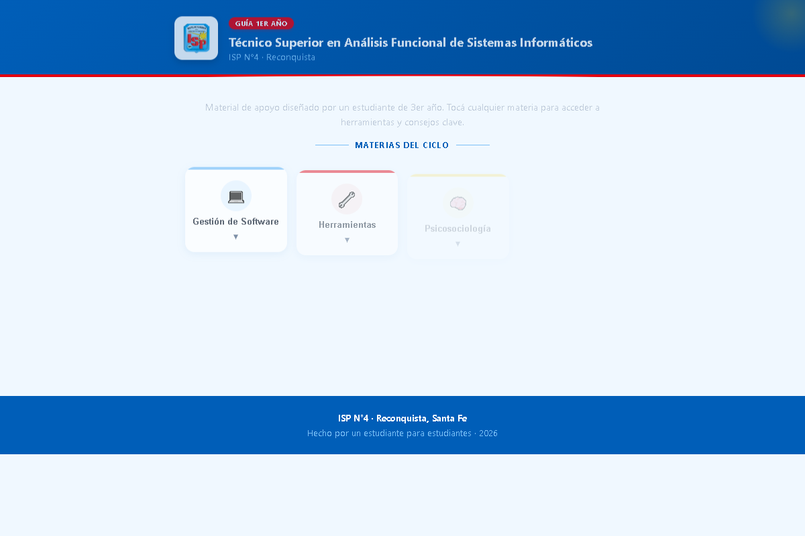
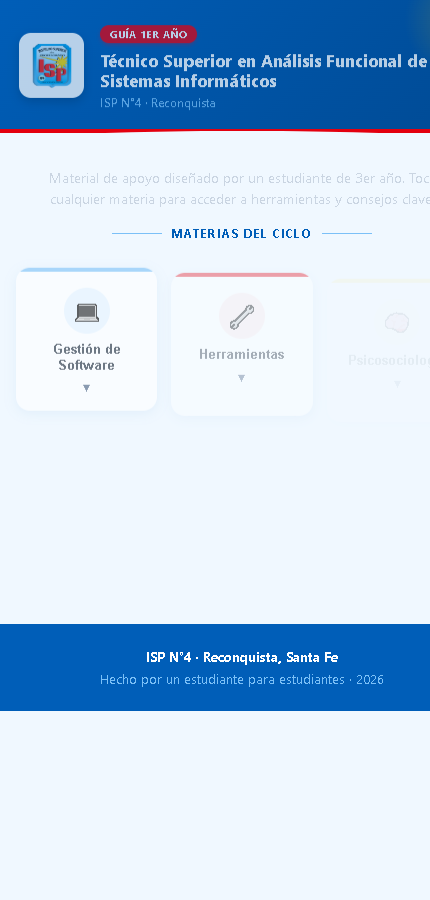

# 🎓 Repositorio Primer Año – Tecnicatura Superior en Análisis Funcional de Sistemas Informáticos

Plataforma web de recursos, apuntes, tareas y evaluaciones correspondientes al primer año de la **Tecnicatura Superior en Análisis Funcional de Sistemas Informáticos** del **ISP N° 4 "Ángel Cárcano"** (Reconquista, Santa Fe, Argentina).

Este sitio funciona como un repositorio centralizado e interactivo, actualmente en constante evolución y crecimiento, pensado para facilitar el acceso a material de estudio estructurado por materias.

---

## 📸 Capturas de Pantalla

A continuación se muestran capturas reales de la interfaz del proyecto en sus versiones de escritorio y dispositivos móviles:

<div align="center">

### Vista Escritorio


### Vista Móvil


</div>

---

## 📚 Materias del Ciclo

El portal organiza el contenido en módulos dinámicos desplegables:

* 💻 **Gestión de Software:** Modelos de ciclo de vida, metodologías de desarrollo y gestión de requerimientos.
* 🔧 **Herramientas de Software:** Utilidades, entornos y herramientas aplicadas al análisis y documentación de sistemas.
* 🧠 **Psicosociología de las Organizaciones:** Estructuras organizacionales, dinámicas de grupos y comunicación institucional.
* 📄 **Formatos y Estándares:** Documentación técnica, especificaciones y modelado de procesos.
* 🌐 **Inglés Técnico:** Comprensión lectora y vocabulario técnico orientado a sistemas e informática.

---

## 🛠️ Tecnologías Utilizadas

* **HTML5:** Marcado semántico y estructura accesible.
* **CSS3 Puro:** Variables personalizadas con la identidad cromática institucional, Grid responsivo (`minmax`), Flexbox y animaciones fluidas sin dependencias externas.
* **JavaScript (Vanilla):** Lógica ligera para el acordeón interactivo y efectos visuales táctiles.
* **Sin dependencias pesadas:** Carga ultra rápida, optimizado para conexiones móviles de bajo ancho de banda.

---

## 🚀 Hoja de Ruta (Roadmap de Crecimiento)

- [ ] Incorporación de guías de trabajos prácticos resueltos por unidad temática.
- [ ] Subida de exámenes anteriores y modelos de evaluación en formato descargable (PDF).
- [ ] Enlaces directos a repositorios de código y diagramas de flujo/UML.
- [ ] Buscador interno de temas y recursos.
- [ ] Modo oscuro (Dark Mode) adaptativo.

---

## 💻 Instalación y Uso Local

Para explorar o desplegar el proyecto localmente:

1. Clonar el repositorio:
   ```bash
   git clone https://github.com/Lurdciano/ProfesoradoPrimero.git
   ```
2. Acceder al directorio:
   ```bash
   cd ProfesoradoPrimero
   ```
3. Abrir `index.html` en el navegador de tu preferencia o servir con una extensión como *Live Server*.

---

## 👤 Autor

**Luciano Ruiz Diaz**
* 🌐 Sitio Web Profesional: [terracode.com.ar](https://terracode.com.ar)
* 🐙 GitHub: [@Lurdciano](https://github.com/Lurdciano)
* 💼 LinkedIn: [luciano-ruizdiaz](https://www.linkedin.com/in/luciano-ruizdiaz)
* ✉️ Correo Electrónico: [lurdciano@gmail.com](mailto:lurdciano@gmail.com)

---

## 📄 Licencia

Este proyecto está disponible bajo la licencia libre y abierta estándar para proyectos educativos y de desarrollo personal.
